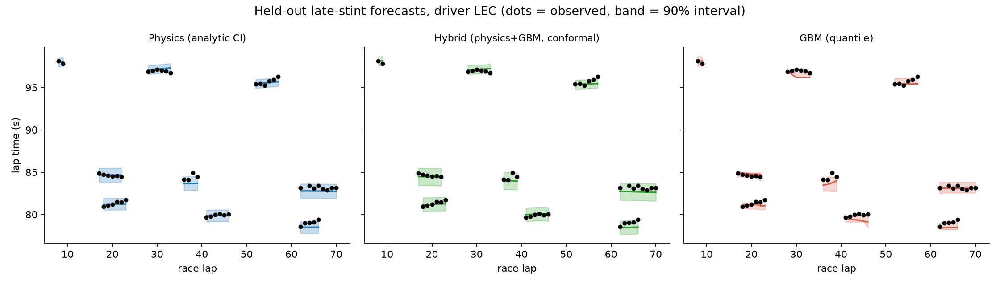
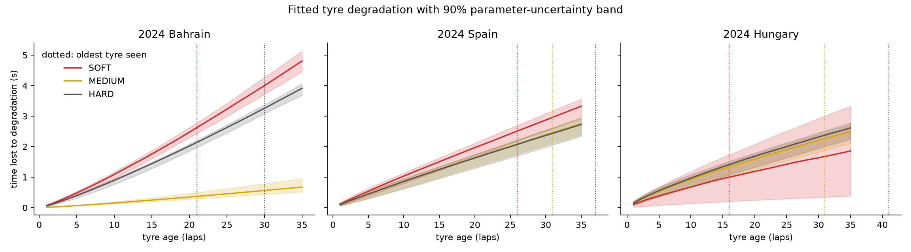
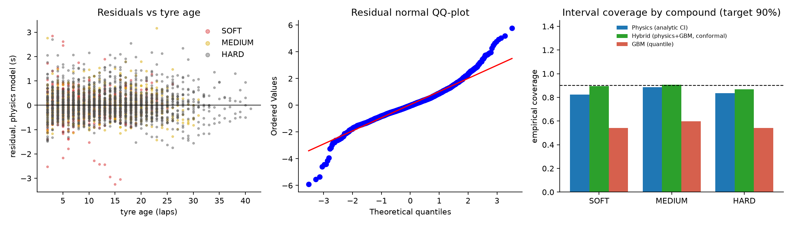
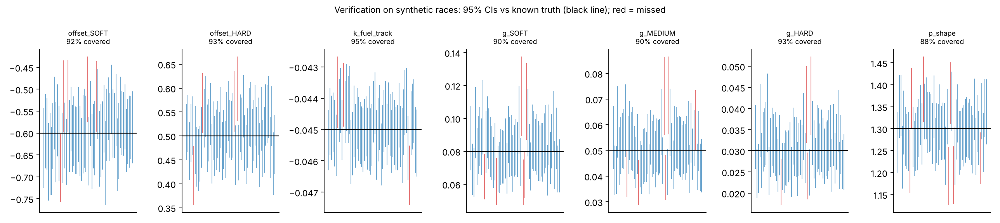

# f1lap: forecasting F1 race lap time with validated uncertainty

[](https://github.com/ChaiebDhia/f1-laptime-uncertainty/actions/workflows/ci.yml)


> **Question.** Can a small physics-structured model forecast race lap time, with *honest* uncertainty, better
> than a generic ML model, especially when it must extrapolate tyre degradation forward in time?

This repo answers it with three models, two out-of-sample validation schemes, a calibration check on the
uncertainty, and a verification step against known ground truth. Public timing data, one command, fully
reproducible.

| Model | What it is | Uncertainty |
|---|---|---|
| **Physics** | `base[driver] + offset[compound] + k·lap + g[compound]·age^p`, fitted per race with SciPy | Parameter covariance propagated to each forecast (delta method) |
| **GBM** | Gradient boosting on driver, compound, lap, tyre age | Quantile-loss models |
| **Hybrid** | Physics backbone + boosted residual correction | Split-conformal, calibrated on held-back stints |

## Quickstart

```bash
git clone https://github.com/ChaiebDhia/f1-laptime-uncertainty.git
cd f1-laptime-uncertainty
python -m venv .venv
source .venv/bin/activate          # Windows: .venv\Scripts\activate
pip install -e ".[dev]"

pytest                             # unit tests, no network needed
f1lap run --synthetic              # full pipeline on generated data, no network needed
f1lap source-check --year 2024 --race Bahrain         # is the data source reachable and as expected?
f1lap run --year 2024 --races Bahrain Spain Hungary   # real data (first run downloads and caches)
f1lap verify                       # parameter-recovery check on synthetic races
f1lap strategy --year 2024 --race Bahrain --pit-loss 22   # tyre strategy under uncertainty
```

Outputs land in `results/`: `REPORT.md` (every number computed, none typed), CSV tables and figures.

## Results

Real-data results from `f1lap run` (full tables in [`results/REPORT.md`](results/REPORT.md)):





**Key findings**

<!-- REPLACE this block with 3 bullets taken from results/REPORT.md after your real-data run. -->
- _See `results/REPORT.md` for this run's accuracy, interval coverage and fitted parameters._

## Data sources

| Source | Needs | Notes |
|---|---|---|
| **OpenF1** (default, `--source openf1`) | nothing; free, no account | Historical data from 2023. Tyre compound, stints, pit stops, race control. Green-flag laps are approximated from race-control messages |
| **FastF1** (`--source fastf1`) | an F1TV Access account | Formula 1 put its data APIs behind a login in October 2026; FastF1 3.9 prompts for it |

Both feed the same cleaning and validation code. Raw data is cached locally (`.openf1_cache/`,
`.fastf1_cache/`) and never committed.

## How the evaluation is built (the part that matters)

- **Split by stint, never by lap.** Laps in a stint are strongly dependent, so a random lap split leaks.
- **Two tasks.** (1) predict stints never seen; (2) train on the first 70% of each stint and forecast the last 30%.
- **Uncertainty is scored, not decorated.** Each model reports the empirical coverage of its nominal 90%
  interval, interval width, and the interval score. An accurate model with 60% coverage is overconfident.
- **Honest error bars.** RMSE confidence intervals come from a cluster bootstrap over whole stints.
- **Calibration data mimics deployment.** For late-stint forecasting, the hybrid's conformal calibration uses
  the last part of each *training* stint, so calibration residuals reflect extrapolation error.
- **Every dropped lap is accounted for.** The cleaning log shows what was removed and why.

## From forecast to decision

`f1lap strategy` turns the fitted physics model into a tyre-strategy comparison with the parameter
uncertainty carried through: for each legal plan it reports the mean gap to the best plan, a 90% interval on
that gap, and the **probability that the plan is the fastest**. Plans that need a tyre to last longer than any
tyre observed are flagged as extrapolation. It is a model-based what-if (no traffic, safety cars or track
position; pit loss is an input), documented in [`docs/METHODS.md`](docs/METHODS.md).

## Verification on known ground truth

Validation asks whether a model suits reality; verification asks whether the code recovers the truth when it is
known. On 60 synthetic races generated from known parameters, the fitted 95% confidence intervals contained the
true values **91.7%** of the time (88% for the shape parameter): slightly optimistic, as expected from
linearising a power-law exponent, and reported as is.



## Engineering

- Installable package (`src/` layout, `f1lap` CLI), type-annotated, linted with Ruff.
- 37 tests covering cleaning, validation, models, splits, metrics and strategy maths (hand-computed values),
  robustness to outliers, and the CLI end to end. The FastF1 loader is tested against a mock session using FastF1's
  documented schema.
- GitHub Actions CI on Python 3.11 and 3.12 (lint, tests, end-to-end smoke runs) plus a Docker build job; Dependabot keeps actions and dependencies current.
- Deterministic: every stochastic step takes a seed.
- Data hygiene: input validation with warnings, a cleaning log, and no raw data committed.

```
src/f1lap/
  data.py        FastF1 loading, cleaning with drop log, validation, synthetic races
  openf1.py      OpenF1 loading (free, no account), caching, retries, green-flag approximation
  models.py      PhysicsLapModel, QuantileGBM, HybridLapModel (+ split-conformal)
  splits.py      stint hold-out, late-stint, calibration splits
  validation.py  schemes, metrics, interval score, cluster bootstrap, coverage by group
  strategy.py    strategy ranking with propagated uncertainty
  verify.py      known-truth parameter recovery
  plots.py       figures        report.py   generated REPORT.md        cli.py   `f1lap run|verify`
docs/METHODS.md  equations, fitting, uncertainty, validation design, limitations
```

Method details, assumptions and limitations: [`docs/METHODS.md`](docs/METHODS.md).

## Limitations

Fuel burn and track evolution are not separable from lap number alone; tyre age and race lap are correlated;
traffic, dirty air, engine modes and weather are not modelled and appear as residual noise; intervals in the
physics model assume constant noise variance; fits are per race. Details in `docs/METHODS.md`.

## Related work

Bayesian state-space models of tyre degradation with compound-specific rates exist
([arXiv:2512.00640](https://arxiv.org/html/2512.00640v1)); this project takes a simpler, fully inspectable
parametric route and puts the weight on validation and calibrated uncertainty.

## Disclaimer

Unofficial project using publicly available timing data through the open-source
[OpenF1](https://openf1.org) API and, optionally, the [FastF1](https://github.com/theOehrly/Fast-F1) library. Not affiliated with, endorsed by or connected to
Formula 1, the FIA or any team. No raw timing data is included in this repository.

## License

MIT, see [LICENSE](LICENSE).
