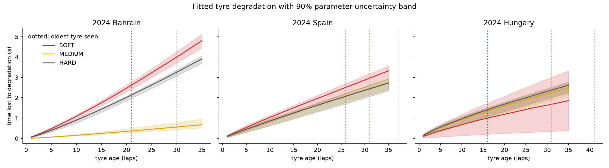
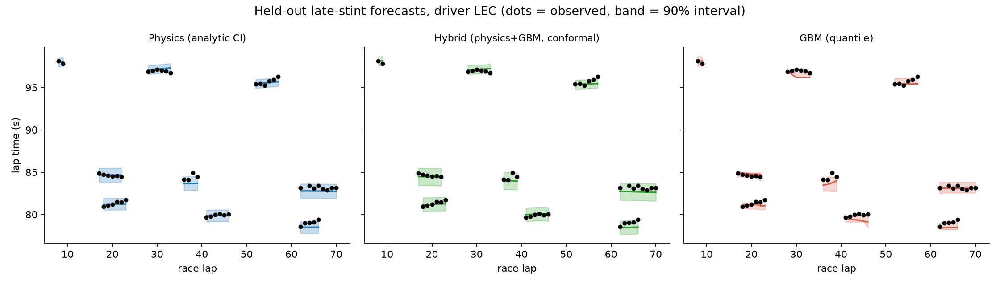
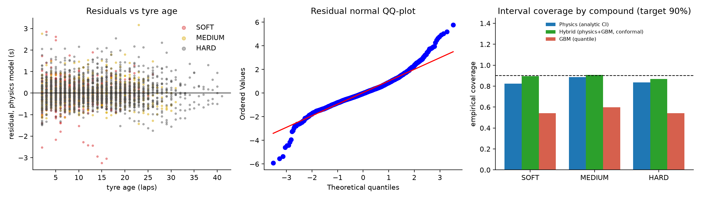

# F1 lap-time uncertainty study: results

_Generated by f1lap 1.0.0 on 2026-11-07. Nominal interval level 90%. All numbers below are computed, not typed._

## 1. Data

| Race | Raw laps | Clean laps | Drivers | Stints | Laps trimmed from fit |
|---|---|---|---|---|---|
| 2024 Bahrain | 1129 | 976 | 20 | 62 | 25 |
| 2024 Spain | 1310 | 1124 | 20 | 62 | 22 |
| 2024 Hungary | 1356 | 1106 | 20 | 56 | 14 |

Cleaning log: 2024 Bahrain

| step | removed | remaining |
|---|---|---|
| raw laps | 0 | 1129 |
| missing lap time or tyre data | 0 | 1129 |
| not a dry compound | 0 | 1129 |
| lap 1 | 20 | 1109 |
| track status not green | 20 | 1089 |
| flagged inaccurate by FastF1 | 0 | 1089 |
| pit in/out lap | 81 | 1008 |
| outside 107% of fastest lap | 32 | 976 |

Cleaning log: 2024 Spain

| step | removed | remaining |
|---|---|---|
| raw laps | 0 | 1310 |
| missing lap time or tyre data | 1 | 1309 |
| not a dry compound | 0 | 1309 |
| lap 1 | 19 | 1290 |
| track status not green | 0 | 1290 |
| flagged inaccurate by FastF1 | 0 | 1290 |
| pit in/out lap | 84 | 1206 |
| outside 107% of fastest lap | 82 | 1124 |

Cleaning log: 2024 Hungary

| step | removed | remaining |
|---|---|---|
| raw laps | 0 | 1356 |
| missing lap time or tyre data | 2 | 1354 |
| not a dry compound | 0 | 1354 |
| lap 1 | 19 | 1335 |
| track status not green | 19 | 1316 |
| flagged inaccurate by FastF1 | 0 | 1316 |
| pit in/out lap | 79 | 1237 |
| outside 107% of fastest lap | 131 | 1106 |

## 2. Out-of-sample validation (pooled over races)

### Unseen stints (5-fold, whole stints held out)

| Model | n laps | MAE (s) | RMSE (s) | RMSE 95% CI | Coverage (target 90%) | Mean width (s) | Interval score |
|---|---|---|---|---|---|---|---|
| Physics (analytic CI) | 3206 | 0.402 | 0.550 | 0.512 to 0.595 | 84.4% | 1.413 | 2.482 |
| Hybrid (physics+GBM, conformal) | 3206 | 0.434 | 0.595 | 0.546 to 0.644 | 88.4% | 1.837 | 2.771 |
| GBM (quantile) | 3206 | 0.514 | 0.677 | 0.625 to 0.724 | 55.5% | 1.071 | 4.465 |

### Late-stint extrapolation (last 30% of each stint)

| Model | n laps | MAE (s) | RMSE (s) | RMSE 95% CI | Coverage (target 90%) | Mean width (s) | Interval score |
|---|---|---|---|---|---|---|---|
| Physics (analytic CI) | 865 | 0.380 | 0.526 | 0.476 to 0.579 | 86.7% | 1.392 | 2.370 |
| Hybrid (physics+GBM, conformal) | 865 | 0.391 | 0.542 | 0.491 to 0.592 | 87.5% | 1.599 | 2.497 |
| GBM (quantile) | 865 | 0.504 | 0.679 | 0.622 to 0.739 | 64.7% | 1.102 | 3.516 |

**Headline**

- **Unseen stints (5-fold, whole stints held out)**: lowest RMSE is Physics (analytic CI) (0.550 s); lowest interval score is Physics (analytic CI). Empirical coverage of the nominal 90% intervals: Physics 84%, Hybrid 88%, GBM 55%.
- **Late-stint extrapolation (last 30% of each stint)**: lowest RMSE is Physics (analytic CI) (0.526 s); lowest interval score is Physics (analytic CI). Empirical coverage of the nominal 90% intervals: Physics 87%, Hybrid 88%, GBM 65%.

**How to read this.** RMSE and MAE measure accuracy. Coverage measures whether the intervals are honest: a model whose 90% intervals cover 60% of outcomes is overconfident however accurate its mean. The interval score (lower is better) combines sharpness and calibration. RMSE confidence intervals resample whole stints because laps within a stint are not independent.

### Per race

| race | scheme | model | n | RMSE_s | coverage | mean_width_s | interval_score |
|---|---|---|---|---|---|---|---|
| 2024 Bahrain | stint_holdout | Physics (analytic CI) | 976 | 0.479 | 0.809 | 1.081 | 2.179 |
| 2024 Bahrain | stint_holdout | Hybrid (physics+GBM, conformal) | 976 | 0.530 | 0.884 | 1.663 | 2.404 |
| 2024 Bahrain | stint_holdout | GBM (quantile) | 976 | 0.710 | 0.536 | 0.946 | 5.126 |
| 2024 Spain | stint_holdout | Physics (analytic CI) | 1124 | 0.516 | 0.864 | 1.402 | 2.438 |
| 2024 Spain | stint_holdout | Hybrid (physics+GBM, conformal) | 1124 | 0.616 | 0.902 | 1.939 | 2.914 |
| 2024 Spain | stint_holdout | GBM (quantile) | 1124 | 0.692 | 0.578 | 1.163 | 4.015 |
| 2024 Hungary | stint_holdout | Physics (analytic CI) | 1106 | 0.634 | 0.854 | 1.719 | 2.795 |
| 2024 Hungary | stint_holdout | Hybrid (physics+GBM, conformal) | 1106 | 0.627 | 0.864 | 1.887 | 2.950 |
| 2024 Hungary | stint_holdout | GBM (quantile) | 1106 | 0.629 | 0.547 | 1.088 | 4.339 |
| 2024 Bahrain | late_stint | Physics (analytic CI) | 256 | 0.411 | 0.867 | 1.041 | 1.882 |
| 2024 Bahrain | late_stint | Hybrid (physics+GBM, conformal) | 256 | 0.475 | 0.820 | 1.057 | 2.373 |
| 2024 Bahrain | late_stint | GBM (quantile) | 256 | 0.618 | 0.512 | 0.814 | 4.022 |
| 2024 Spain | late_stint | Physics (analytic CI) | 304 | 0.518 | 0.872 | 1.402 | 2.376 |
| 2024 Spain | late_stint | Hybrid (physics+GBM, conformal) | 304 | 0.512 | 0.885 | 1.608 | 2.302 |
| 2024 Spain | late_stint | GBM (quantile) | 304 | 0.636 | 0.678 | 1.125 | 3.454 |
| 2024 Hungary | late_stint | Physics (analytic CI) | 305 | 0.613 | 0.862 | 1.677 | 2.773 |
| 2024 Hungary | late_stint | Hybrid (physics+GBM, conformal) | 305 | 0.618 | 0.911 | 2.045 | 2.797 |
| 2024 Hungary | late_stint | GBM (quantile) | 305 | 0.764 | 0.731 | 1.320 | 3.153 |

## 3. Fitted physical parameters

| race | param | estimate | std_err | ci95_low | ci95_high | at_bound |
|---|---|---|---|---|---|---|
| 2024 Bahrain | offset_SOFT | -0.0458 | 0.0538 | -0.1514 | 0.0597 | False |
| 2024 Bahrain | offset_HARD | 0.0234 | 0.0467 | -0.0683 | 0.1151 | False |
| 2024 Bahrain | k_fuel_track | -0.0712 | 0.0008 | -0.0727 | -0.0697 | False |
| 2024 Bahrain | g_SOFT | 0.0705 | 0.0122 | 0.0465 | 0.0945 | False |
| 2024 Bahrain | g_MEDIUM | 0.0100 | nan | nan | nan | False |
| 2024 Bahrain | g_HARD | 0.0571 | 0.0104 | 0.0367 | 0.0775 | False |
| 2024 Bahrain | p_shape | 1.1922 | 0.0546 | 1.0850 | 1.2994 | False |
| 2024 Spain | offset_SOFT | -0.2014 | 0.0713 | -0.3412 | -0.0616 | False |
| 2024 Spain | offset_HARD | 0.1357 | 0.0751 | -0.0117 | 0.2831 | False |
| 2024 Spain | k_fuel_track | -0.0602 | 0.0011 | -0.0623 | -0.0581 | False |
| 2024 Spain | g_SOFT | 0.1168 | 0.0301 | 0.0577 | 0.1760 | False |
| 2024 Spain | g_MEDIUM | 0.0962 | 0.0251 | 0.0469 | 0.1456 | False |
| 2024 Spain | g_HARD | 0.0958 | 0.0264 | 0.0440 | 0.1476 | False |
| 2024 Spain | p_shape | 0.9490 | 0.0733 | 0.8052 | 1.0928 | False |
| 2024 Hungary | offset_SOFT | -0.0345 | 0.3095 | -0.6419 | 0.5728 | False |
| 2024 Hungary | offset_HARD | 0.0643 | 0.0823 | -0.0971 | 0.2257 | False |
| 2024 Hungary | k_fuel_track | -0.0449 | 0.0009 | -0.0467 | -0.0431 | False |
| 2024 Hungary | g_SOFT | 0.1081 | 0.0579 | -0.0055 | 0.2218 | False |
| 2024 Hungary | g_MEDIUM | 0.1405 | 0.0396 | 0.0628 | 0.2183 | False |
| 2024 Hungary | g_HARD | 0.1477 | 0.0434 | 0.0626 | 0.2328 | False |
| 2024 Hungary | p_shape | 0.8147 | 0.0752 | 0.6671 | 0.9623 | False |

Sanity checks (heuristic, not proof):

| Race | k in heuristic band | g ordered soft>=med>=hard | any parameter at bound |
|---|---|---|---|
| 2024 Bahrain | yes | no | no |
| 2024 Spain | yes | yes | no |
| 2024 Hungary | yes | no | no |

`k` is the combined fuel-burn and track-evolution effect; engineering rules of thumb (about 0.03 s/kg, 1.5 to 2 kg burned per lap) suggest roughly -0.12 to -0.02 s/lap. A parameter at its bound means the data could not identify it and its confidence interval should not be trusted.

## 4. Figures

**Fitted tyre degradation with parameter uncertainty**

**Late-stint forecasts on held-out laps**

**Residual diagnostics and coverage by compound (unseen stints)**

## 5. Limitations

- Fuel burn and track evolution are not separable from lap number alone.
- Tyre age and race lap are correlated; identifiability comes from staggered stints.
- Traffic, dirty air, engine modes, fuel saving and weather are not modelled; they appear as residual noise (see diagnostics).
- Per-race fits: parameters are not comparable across circuits without a hierarchical model.
- Unofficial public timing data; not affiliated with Formula 1 or any team.
