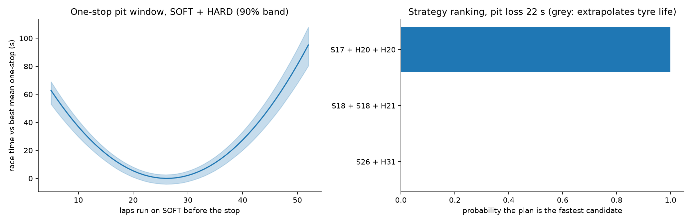

# Strategy what-if: 2024 Bahrain

Race distance 57 laps, pit-lane time loss 22.0 s (an input, not an estimate).

**Assumptions.** Model-based what-if on the fitted physics model: no traffic, safety cars, track position, tyre warm-up or engine modes; two different dry compounds required; stint order does not change race time in this model.

```
           plan  stops  mean_gap_s  gap_p05_s  gap_p95_s  P_fastest  extrapolates_tyre_life
S17 + H20 + H20      2       0.000      0.000      0.000        1.0                   False
S18 + S18 + H21      2       2.732      1.900      3.557        0.0                   False
      S26 + H31      1      13.160     10.837     14.922        0.0                    True
```


